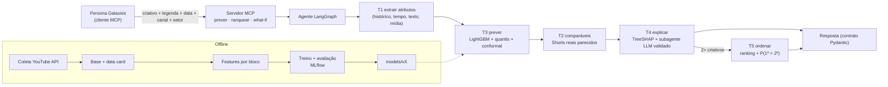

<div align="center">

# 🔭 Parallax

### Quantas curtidas este Short vai ter? Pergunte **antes** de publicar.

Modelo preditivo + agente, entregues como tool (função Python e servidor MCP) para a persona sintética da Galaxies.

[](pyproject.toml)
[](scripts/07_treinar.py)
[](src/parallax/agent/graph.py)
[](src/parallax/mcp_server.py)
[](tests/)
[](#instala%C3%A7%C3%A3o-e-execu%C3%A7%C3%A3o)

**19.211 Shorts reais** · **89 canais** · moda · beleza · automotivo

| Acerto entre 2 criativos do mesmo canal | Intervalo de 80% | Canais nunca vistos |
|:---:|:---:|:---:|
| **58,2%** _(baseline: 51,0%)_ | **81,0%** de cobertura | **58,5%** |

[Como funciona](docs/pipeline.md) · [Resultados](#resultados) · [Base de dados](docs/data_card.md) · [Modelo](docs/model_card.md) · [Experimento](docs/experiment_report.md) · [Demo](docs/resultados/demo.md)

</div>

> Na astronomia, a **paralaxe** mede a distância de uma estrela comparando dois pontos de vista. O Parallax estima o alcance de um criativo comparando o conteúdo com o histórico do canal.

---

## Problema e recorte

| | |
|---|---|
| **Decisão apoiada** | Escolher, entre criativos candidatos, quais publicar ou impulsionar, antes de gastar verba |
| **Unidade** | Um Short (vídeo vertical de até 3 min) de um canal de marca ou criador |
| **Momento da previsão** | Antes da publicação. Usa só o criativo, a legenda, a data planejada e o histórico do canal |
| **Alvo** | Curtidas, em escala log e relativas à mediana dos 20 Shorts anteriores do canal. Views foram descartadas porque a contagem de Shorts mudou em 31/03/2025 e em 24/08/2026 |
| **Setores** | Moda, beleza e automotivo |
| **Critério de sucesso** | Superar o baseline "mediana histórica do canal" em validação temporal, com foco em **ordenar certo os criativos de um mesmo canal** (meta: acurácia par a par ≥ 60%), e entregar um intervalo de 80% calibrado |

**Princípio central:** o número sempre vem de um modelo estatístico treinado e avaliado (LightGBM). O LLM orquestra e explica, mas **nunca estima a métrica**. Um teste automatizado garante que o número da tool é o número do modelo, e um validador determinístico reprova explicações que citem números ou fatores fora do JSON do modelo.

## Dados

**19.211 Shorts de 89 canais** (80 de treino e 9 guardados para a demo), coletados pela YouTube Data API v3 em 15/10/2026, com as estatísticas recoletadas em 16/10/2026.

| | |
|---|---|
| Setores | automotivo 7,8 mil · moda 6,9 mil · beleza 4,6 mil |
| Período | out/2024 a set/2026 |
| Filtros | vertical, duração ≤ 60 s ou ≤ 180 s conforme a data, ≥ 30 dias de idade, curtidas visíveis, sem lives e sem duplicatas |
| Cota usada | ~2.400 unidades no total; nunca usamos `search.list` para listar vídeos |

Funil, esquema, termos de uso, o que a base **não** representa e vieses: [docs/data_card.md](docs/data_card.md).

## Arquitetura

> Fluxo completo, etapa por etapa, com diagramas: **[docs/pipeline.md](docs/pipeline.md)**.



| Componente | O que faz |
|---|---|
| `collect/youtube.py` | Cliente da YouTube Data API com controle de cota e retry só para erros transitórios |
| `data/history.py` | Features do canal usando **apenas posts anteriores** ao criativo (teste anti-vazamento) |
| `features/` | Blocos de features: canal, tempo, texto (medidas + embedding MiniLM), mídia (OpenCV, cortes, rosto, OCR, objetos, Whisper, SigLIP2) e VLM (rubrica JSON no Gemini) |
| `model/` | Treino (LightGBM), métricas com bootstrap por canal, calibração conformal (CQR) |
| `inference.py` | API principal `prever_criativo()`, composta pelas 5 tools |
| `agent/graph.py` | StateGraph LangGraph que chama as tools e guarda a trilha de cada passo |
| `explain/` | Validador determinístico e subagente explicador (Gemini) |
| `mcp_server.py` | Servidor MCP (FastMCP) que expõe o agente |

**O número vem do modelo, não do LLM.** O LLM só aparece na T4, e o texto dele passa pelo validador.

## Instalação e execução

Pré-requisitos: Windows, macOS ou Linux, [uv](https://docs.astral.sh/uv/) e Node 18+ (só para o MCP Inspector).

```bash
uv sync
```

```bash
cp .env.example .env
```

Preencha `YOUTUBE_API_KEY` (Google Cloud, YouTube Data API v3, cota gratuita) e `GEMINI_API_KEY` (Google AI Studio, free tier) no `.env`. O Gemini é opcional: sem ele, a camada VLM fica de fora e a explicação usa o template.

**Usar o modelo já treinado** (artefatos em `models/`):

```python
from datetime import datetime
from parallax.inference import prever_criativo
from parallax.schemas import PredictionRequest

r = prever_criativo(PredictionRequest(
    creative="https://www.youtube.com/shorts/<id>",       # ou caminho de vídeo, imagem ou texto
    caption="Make em 30s 💄\nlink na bio #shorts",
    planned_datetime=datetime(2026, 10, 24, 18, 0),
    sector="beleza",
    channel_id="UC...",                                   # ou channel_stats={...} (dispensa a API)
))
print(r.predicted_metric, r.interval_low, r.interval_high, r.explanation)
```

**Servidor MCP** (stdio):

```bash
uv run python src/parallax/mcp_server.py
```

```bash
npx @modelcontextprotocol/inspector uv run python src/parallax/mcp_server.py
```

Configuração para um cliente MCP (ex.: Claude Desktop):

```json
{"mcpServers": {"parallax": {"command": "uv", "args": ["--directory", "<caminho>/case-galaxies", "run", "python", "src/parallax/mcp_server.py"]}}}
```

**Reproduzir do zero** (cada script é idempotente e retomável):

| Passo | Comando | Tempo aproximado |
|---|---|---|
| 1. Coleta | `uv run python scripts/01_coletar.py` | ~10 min, ~2 mil unidades de cota |
| 2. Base v1 + funil | `uv run python scripts/02_montar_base.py` | 1 min |
| 3. Recoleta (base v2) | `uv run python scripts/03_recoletar_metricas.py` | 2 min |
| 4. Thumbnails | `uv run python scripts/04_extrair_thumbnails.py` | ~2 h em CPU |
| 5. Camada 1 de mídia | `uv run python scripts/05_extrair_midia.py --parte 0/2` (+ `1/2` em paralelo) | ~13 s por vídeo |
| 6. VLM | `uv run python scripts/06_extrair_vlm.py` (1x por dia; cota) | ~500 vídeos por dia |
| 7. Treino + avaliação | `uv run python scripts/07_treinar.py` | ~12 min |
| 8. Ablação multimodal | `uv run python scripts/08_ablacao.py` | ~10 min |
| 9. Análise de erros | `uv run python scripts/09_analise_erros.py` | 2 min |
| 10. Demo | `uv run python scripts/10_demo.py` | 3 min |

```bash
uv run pytest
```

## Estrutura do projeto

```
parallax/
├── src/parallax/              # o pacote
│   ├── schemas.py             # contrato Pydantic (entrada e saída da tool)
│   ├── inference.py           # API principal: as 5 tools + ranking + what-if
│   ├── mcp_server.py          # servidor MCP (FastMCP)
│   ├── config.py              # caminhos, versão do modelo, constantes
│   ├── collect/               # cliente da YouTube Data API (cota, retry)
│   ├── data/                  # histórico do canal, filtros, splits
│   ├── features/              # blocos: texto, mídia, VLM, registro
│   ├── model/                 # treino, métricas com IC, conformal
│   ├── explain/               # narrador LLM + validador determinístico
│   └── agent/graph.py         # orquestrador LangGraph
├── scripts/                   # pipeline numerada, na ordem de execução
├── tests/                     # 14 testes (vazamento, contrato, agente, MCP)
├── models/v1/                 # modelo treinado + model card em JSON
├── docs/                      # data card, model card, relatório, pipeline
│   └── resultados/            # tabelas geradas pelos scripts
├── demo/respostas/            # saídas reais da tool (plano B da apresentação)
└── data/canais.csv            # curadoria dos 89 canais (o resto é gerado)
```

## Modelos e configurações

- **Versões fixadas** em `pyproject.toml` / `uv.lock`, seguindo o stack 2026 da liga. Python 3.12.
- **LightGBM** (`model/train.py`): `learning_rate=0.03`, `num_leaves=31`, `min_child_samples=50`, `subsample=0.8`, `colsample_bytree=0.8`, `reg_lambda=1`, early stopping de 200 rodadas no val temporal.
- **Intervalo**: quantis 0,1 e 0,9 do LightGBM + calibração conformal (CQR) na fatia de validação.
- **Embeddings**: texto `paraphrase-multilingual-MiniLM-L12-v2` (PCA-32); imagem `google/siglip2-base-patch16-224` (PCA-16).
- **VLM**: `gemini-3.5-flash-lite`, com o vídeo lido direto pela URL do YouTube.
- **Rastreio**: MLflow (`mlflow.db`, experimento `parallax-modelo-a`). Artefatos em `models/vX/` com `meta.json` (data de corte, versão da base, métricas).

## Metodologia

- **Split temporal** (principal): treino até 29/04/2026, validação até 09/07/2026, teste de 09/07 a 15/09/2026. **Split por canal** (GroupKFold) para medir o cenário "cliente novo". Os 9 canais de demo ficam fora de tudo.
- **Sem vazamento**: o histórico do canal usa só posts anteriores; nenhuma métrica pós-publicação vira feature; PCA, thresholds e calibração são ajustados só no treino ou na validação. Tudo coberto por testes.
- **Baselines**: B0 mediana dos 20 posts anteriores do canal, B1 média, B2 regressão linear sobre inscritos, B3 mediana do setor.
- **Métricas**: MAE e MAPE em log, Spearman global e intra-canal, **acurácia par a par intra-canal** (métrica de decisão), cobertura do intervalo de 80% e F1 nas faixas. IC95% por bootstrap de canais, pareado entre modelos.
- **Hipóteses** registradas antes do treino: [docs/experiment_report.md](docs/experiment_report.md).

## Resultados

**Teste temporal** (2.543 Shorts, modelo `v1`, base v2):

| Modelo | MAE log | Spearman global | Spearman intra | **Par a par intra** | Δ vs B0 (IC95%) |
|---|---|---|---|---|---|
| B0 mediana do canal | 0,750 | 0,865 | −0,02 | 51,0% | — |
| M1 canal + tempo | 0,710 | 0,888 | 0,08 | 55,5% | +4,5 p.p. [3,1; 6,3] |
| **M2 + texto (v1)** | 0,716 | 0,888 | 0,09 | **58,2%** | **+7,2 p.p. [5,8; 8,9]** |

- O modelo ordena criativos do mesmo canal **7 p.p. melhor que o baseline**, com IC acima de zero. Ainda fica no limite da meta de 60% (IC de 55,7% a 61,0%).
- **Intervalo de 80% calibrado (CQR): cobertura de 81,0% no teste**, com 79,7% a 81,7% por setor. Sem a calibração, seria 75,1%.
- **Otimismo da CV aleatória medido**: ela daria 64,1% (+6 p.p. falsos), porque mistura fases do mesmo canal entre treino e teste.
- Literatura (SMP, SMTPD): Spearman de 0,55 a 0,85 antes da publicação. Nosso global é 0,89, dominado pelo tamanho do canal; o intra-canal, que é o que importa para a decisão, é bem menor.
- Detalhes: [model card](docs/model_card.md) e [relatório](docs/experiment_report.md).

**Demo nos 9 canais nunca vistos** (36 criativos, v1): acerto par a par **58,5%** e cobertura do intervalo de 75%, coerentes com o teste. Detalhes em [docs/resultados/demo.md](docs/resultados/demo.md).

**Camada multimodal** (1.079 Shorts de teste com vídeo processado): somar thumbnail, frames, vídeo, áudio e VLM **melhora a ordenação dentro do canal** — Spearman intra-canal de 0,132 para **0,230** (Δ +0,10, IC95% [0,040; 0,164]), o dobro dos +0,02 a +0,04 que a literatura esperava; o áudio é o maior salto isolado. Mas **não** melhora a acurácia par a par (IC inclui zero), que é o critério de decisão, então ela **não entra no número** do v1: a tool extrai e expõe os atributos do vídeo em `features_used` para inspeção da persona. Tabela, controle e discussão: [ablação](docs/resultados/ablacao_multimodal.md).

## Limitações

- **Ganho modesto sobre o histórico**: o histórico do canal domina a previsão; o conteúdo acrescenta alguns pontos de ordenação, como a literatura prevê.
- **Impulsionamento pago é invisível**: os piores erros são de canais que alternam posts orgânicos com posts que parecem impulsionados (ex.: dezenas vs. centenas de milhares de curtidas no mesmo canal). A API não informa isso.
- **Erro maior** em canais com mais de 10 milhões de inscritos, em moda e em canais brasileiros ([análise de erros](docs/resultados/analise_erros.md)).
- **Base curada**: marcas grandes e criadores famosos sobrerrepresentados; moda tem só 2 criadores; só YouTube, só posts orgânicos.
- **Inscritos "de hoje"**: a API só dá o número atual, não o da data do post. O modelo se apoia no histórico de curtidas, que é correto no tempo.
- **Camada multimodal medida, mas não integrada ao número**: melhora o Spearman intra-canal (+0,10, significativo), não a acurácia par a par; a thumbnail usada no treino não existe antes da publicação de um criativo novo, o que impediria a paridade treino/inferência. Extraída em um subconjunto de ~2 mil vídeos, por limite de CPU (sem GPU) e da cota diária do VLM.
- **Uso indevido**: a previsão é um apoio à decisão, não uma garantia. Não usar para canais sem histórico de Shorts, outras plataformas ou decisões automáticas sem revisão humana.

## Próximos passos (com mais 4 semanas)

1. Extrair a camada multimodal na base inteira com GPU (Colab/Kaggle) e embeddings de vídeo completo (X-CLIP/VideoMAE).
2. Treinamento dinâmico: tool que treina um modelo especialista com a base de ads de um cliente (o pipeline já aceita o esquema mínimo).
3. Detectar posts impulsionados (picos atípicos) e tratá-los à parte.
4. Calibração conformal adaptativa por setor e recalibração periódica.
5. Comparar com um LLM zero-shot nos mesmos pares, para quantificar o ganho do modelo treinado.
