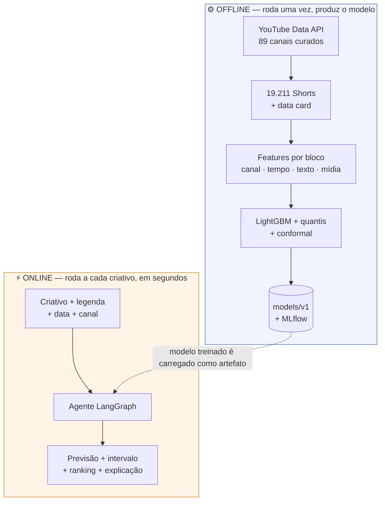
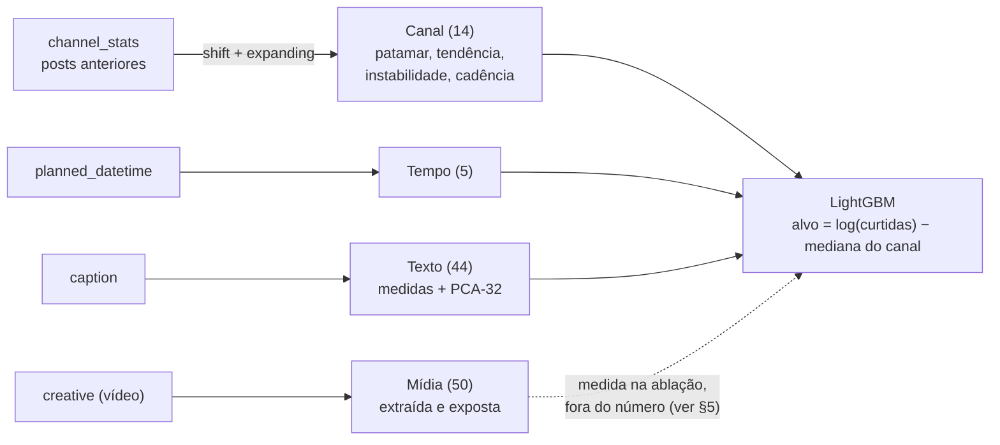
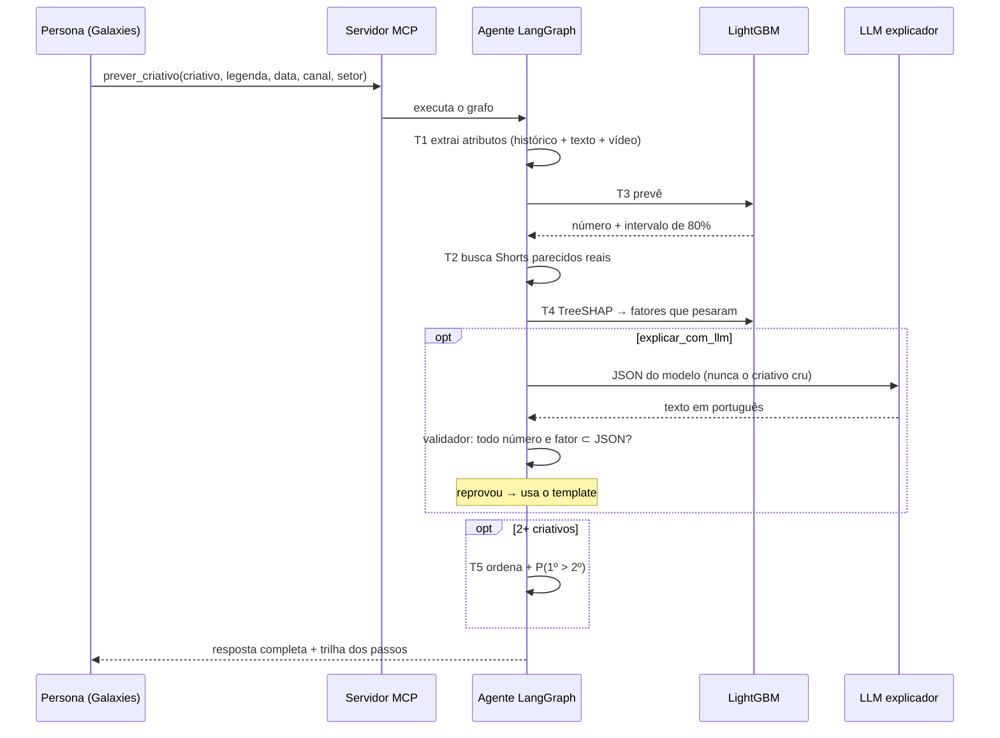

# Como o Parallax funciona

**Documentação técnica do fluxo, da coleta à resposta da tool.**

[Visão geral](#1-visão-geral) · [Pipeline offline](#2-pipeline-offline-dados--modelo) · [Fluxo online](#3-fluxo-online-a-tool-respondendo) · [As 5 tools](#4-as-5-tools-por-dentro) · [Decisões](#5-decisões-de-projeto-e-o-porquê) · [Números](#6-números-de-referência)

---

## 1. Visão geral

O Parallax tem **duas metades que nunca se misturam**:

**A regra que organiza tudo:** o número sai do modelo estatístico treinado offline. O LLM aparece só no fim, para traduzir o resultado em português, e passa por um validador que reprova qualquer número ou fator que não esteja no JSON do modelo.

---

## 2. Pipeline offline (dados → modelo)

Cada etapa é um script numerado, idempotente e retomável. Rodar de novo não duplica nem reprocessa nada.

```mermaid
flowchart LR
    S1["01 coletar<br/><small>API v3</small>"] --> S2["02 montar base<br/><small>filtros + funil</small>"]
    S2 --> S3["03 recoletar<br/><small>métricas maduras</small>"]
    S3 --> S4["04 thumbnails<br/><small>+ SigLIP2</small>"]
    S4 --> S5["05 mídia<br/><small>vídeo + áudio</small>"]
    S5 --> S6["06 VLM<br/><small>rubrica JSON</small>"]
    S6 --> S7["07 treinar<br/><small>GBM + conformal</small>"]
    S7 --> S8["08 ablação<br/><small>ganho por bloco</small>"]
    S8 --> S9["09 erros<br/><small>onde falha</small>"]
    S9 --> S10["10 demo<br/><small>de-para</small>"]
```

| # | Script | O que faz | Saída | Tempo |
|---|---|---|---|---|
| 01 | `01_coletar.py` | Resolve os canais da curadoria e lista os Shorts pela playlist de uploads. Conta a cota e para com segurança se ela acabar | `data/raw/coleta=AAAA-MM-DD/` | ~10 min |
| 02 | `02_montar_base.py` | Aplica os filtros (Shorts, ≥30 dias, curtidas visíveis) e registra o funil de cada etapa | `base_v1.parquet` + `funil_v1.json` | 1 min |
| 03 | `03_recoletar_metricas.py` | Recoleta curtidas e inscritos antes do treino final, como pede a política da API | `base_v2.parquet` | 2 min |
| 04 | `04_extrair_thumbnails.py` | Baixa as 19 mil thumbnails e gera o embedding visual | `emb_thumb.parquet` | ~2 h |
| 05 | `05_extrair_midia.py` | Por vídeo: baixa em 360p, extrai frames, cortes, cor, movimento, rosto, texto na tela, objetos e áudio, **e apaga o vídeo** | `data/media/<id>/media.json` | ~13 s/vídeo |
| 06 | `06_extrair_vlm.py` | O Gemini assiste ao Short pela URL e preenche a rubrica do TAPI em JSON | `data/media/<id>/vlm.json` | ~500/dia (cota) |
| 07 | `07_treinar.py` | Baselines, LightGBM, quantis, calibração conformal, métricas com IC e registro no MLflow | `models/v1/` | ~12 min |
| 08 | `08_ablacao.py` | Mede o ganho de cada bloco multimodal, um por vez, com grupo de controle | `ablacao_multimodal.md` | ~15 min |
| 09 | `09_analise_erros.py` | Fatia o erro por setor, tamanho de canal, duração e idioma; lista os piores casos com link | `analise_erros.md` | 2 min |
| 10 | `10_demo.py` | Roda a tool nos 9 canais nunca vistos e compara previsto vs. real | `demo.md` + `demo/respostas/` | 3 min |
| 11 | `11_cliente_mcp.py` | Consome o servidor MCP como a persona faria, em processo separado | — | 1 min |

### Como as features são construídas

**O cuidado central:** para prever um post, o modelo só enxerga posts **publicados antes dele**. Um teste automatizado altera as curtidas de todo o futuro e confirma que nenhuma feature do passado muda.

---

## 3. Fluxo online (a tool respondendo)

### O que volta na resposta

| Campo | Exemplo |
|---|---|
| `predicted_metric` | `1118.4` |
| `interval_low` / `interval_high` | `579.7` / `2875.4` |
| `relative_to_channel` | `0.97` (um pouco abaixo da mediana do canal) |
| `confidence_flag` + `confidence_reasons` | `false`, `[]` |
| `top_drivers` | `dias desde o último post (aumenta, +0,15)` |
| `comparables` | 5 Shorts reais do setor, com curtidas e link |
| `explanation` | "Acho que este criativo vai performar acima do padrão do canal..." |
| `features_used` | todas as features, inclusive `midia_*`, para inspeção |
| `warnings` | de onde veio a explicação, o que faltou |

---

## 4. As 5 tools por dentro

| Tool | Função | O que garante |
|---|---|---|
| **T1** extração | `extrair_atributos()` | Usa o **mesmo código** de features do treino, o que evita divergência entre treinar e prever |
| **T2** comparáveis | `comparaveis()` | Shorts reais parecidos, no máximo 2 por canal, para a evidência não vir toda do mesmo lugar |
| **T3** predição | `prever()` | **A única fonte do número.** Ponto, quantis e calibração conformal |
| **T4** explicabilidade | `explicar()` + narrador | TreeSHAP agrupado, com rótulos em português, mais o texto validado |
| **T5** ordenação | `ordenar()` | Ranking e a probabilidade de o 1º superar o 2º, a partir da largura dos intervalos |

O agente é um grafo **determinístico**: a ordem das tools não depende do humor do LLM. Ele só decide duas coisas: buscar mais evidência quando a confiança é baixa, e ordenar quando há mais de um criativo.

---

## 5. Decisões de projeto e o porquê

| Decisão | Motivo |
|---|---|
| **Alvo relativo ao canal**, não curtidas absolutas | Um canal com 10 milhões de inscritos sempre terá mais curtidas. A pergunta real é "este criativo é melhor que os meus de costume?" |
| **Curtidas, não views** | A contagem de views de Shorts mudou em 31/03/2025 e em 24/08/2026; curtidas são comparáveis no tempo |
| **Só Shorts com 30 dias ou mais** | Antes disso as curtidas ainda estão crescendo, e a recoleta confirmou: a variação em 1 dia foi de 1,00× |
| **Curtidas ocultas viram ausentes, nunca zero** | Tratar como zero ensinaria o modelo a prever fracasso onde há só falta de dado |
| **Split temporal, nunca aleatório** | Medimos: o aleatório daria +6 p.p. de otimismo falso, por misturar fases do mesmo canal |
| **Acurácia par a par como métrica de decisão** | É a pergunta do cliente: entre dois criativos, qual publicar? |
| **Calibração conformal** | Sem ela o intervalo de 80% cobria 75%; com ela, 81% |
| **Vídeo extraído, mas fora do número** | Melhora a ordenação (Spearman +0,10, significativo), mas não o par a par; e a thumbnail do treino não existe antes de publicar |
| **O LLM nunca gera o número** | Um teste prova que o número da tool é o do modelo; um validador reprova explicações inventadas |

---

## 6. Números de referência

| | Baseline | **Parallax v1** |
|---|---|---|
| Acerto entre dois criativos do mesmo canal | 51,0% | **58,2%** (+7,2 p.p.) |
| Cobertura do intervalo de 80% | — | **81,0%** |
| Demo em canais nunca vistos | — | **58,5%** |

- **Base:** 19.211 Shorts · 89 canais · 3 setores · out/2024 a set/2026
- **Camada multimodal:** 2.049 vídeos processados · Spearman intra-canal 0,132 → **0,230**
- **Cota usada:** ~2.400 de 10.000 unidades/dia da YouTube API
- **Custo:** zero. Tudo em free tier e CPU local

Detalhes: [data card](data_card.md) · [model card](model_card.md) · [relatório](experiment_report.md) · [resultados](resultados/)
